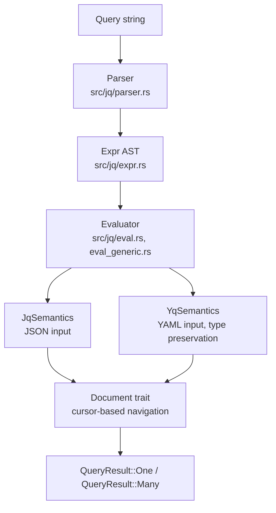

# jq Evaluator

[Home](../../) > [Docs](../) > [Reference](./) > jq Evaluator

A jq-compatible query language implementation that works with succinctly's semi-indexed documents, supporting both JSON and YAML inputs.

## What It Does

The jq module provides `parse()` and `eval()` functions that execute jq expressions against semi-indexed documents without building a DOM:

```rust
use succinctly::jq::{parse, eval, JqSemantics, QueryResult};
use succinctly::json::{JsonIndex, StandardJson};

let json = br#"{"users": [{"name": "Alice"}, {"name": "Bob"}]}"#;
let index = JsonIndex::build(json);
let cursor = index.root(json);

let expr = parse(".users[].name").unwrap();
let result = eval::<Vec<u64>, JqSemantics>(&expr, cursor);
```

## Architecture



### Generic over Document

The evaluator is generic over a `Document` trait, which is implemented by both `JsonIndex` and `YamlIndex` cursors. This means the same jq expression AST works for both JSON and YAML inputs.

### Evaluation Semantics

| Mode           | Used By      | Behavior                                            |
|----------------|--------------|-----------------------------------------------------|
| `JqSemantics`  | `sjq` (JSON) | Standard jq behavior                                |
| `YqSemantics`  | `syq` (YAML) | Preserves YAML types (quoted strings stay strings)  |

### Owned values and long number literals

A document number keeps its source token in `OwnedValue::NumberLiteral`. The internal
reindex bridge now writes that token verbatim at every length, so a filter sees the
same decimal value whether it reads the original cursor or a materialized value.
Computed floats retain their separate internal token, and NaN retains its sentinel.

The evaluator runs a bounded set of operations directly on owned state: entries
conversion, literal numeric updates to an existing object field, and their
supported pipes. Other expressions still use the lossless reindex bridge. Loop
results can be projected through the sink before array collection, so
`[while(.i < N; .i += 1) | .i]` stores only projected integers. An array
requesting all complete states still stores those states.

A generator that emits a large computed container into a later pipe stage
(`range([]; {}; [1]) | ...`, `while(...; . + [1]) | ...`) reaches the bridge once
per output, and the bridge serializes and indexes the whole container each time:
linear per output, quadratic over the run. A few stages therefore answer from the
owned tree instead -- `length`, a leading `.field`/`.[n]`, and (#3439) `select(cond)`
when `cond` is a comparison/boolean over `type`, `length` of an array or object and
navigation -- and any other stage still pays the bridge. The producing loop is not
the cost: `range/3`'s generic loop appends to its accumulator in place once its
consumer lets go of each value; only a consumer that *keeps* every value forces a
copy per step, in jq as well (`/usr/bin/jq` 1.7.1: 0.16 s at 10,000 steps, 0.71 s at 20,000).

See [the #3025 spike](../plan/issue-3025-spike.md) for the 200,000-digit
cost and the [implementation results](../plan/issue-3025-results.md).

### Path mode: the carried register

jq's `path(f)` runs `f` with a register `(path, value)` that only navigation advances, and checks
it with pointer identity (`jv_identical`) at every index, `getpath` and the end of the path. A
jq-mode program whose path target is more than navigation -- an argument of `path`/`del`/`pick`,
or an assignment target, that binds, folds, branches, retries a `?//` or calls a function -- runs
whole through the path-mode interpreter ([src/jq/path_mode.rs](../../src/jq/path_mode.rs)), which
carries that register with every output instead of inferring it. Its values use `OwnedValue`'s
storage identity (shared containers, promoted strings and number literals), and jq's C builtins
that hand back their input are listed in `src/jq/c_builtin_identity.rs`. Navigation-only targets
and value filters over them (`select`, `//`, `first`, a caught `try`) stay on the streaming
walkers. See [ADR-0026](../adrs/adr-0026.md) for the decision and the
[Phase 0 spike report](../plan/jq-path-mode-interpreter-spike.md) for how it was measured.

### Streaming

For large outputs, the evaluator supports streaming via `StreamableValue`, writing results incrementally without buffering the entire output. The YAML identity query (`yq '.'`) uses direct cursor-to-JSON streaming (P9 optimization).

## Supported Syntax

The implementation covers a substantial subset of jq:

- **Navigation**: `.field`, `.[n]`, `.[]`, `.[n:m]`, `..` (recursive descent)
- **Construction**: `[expr]` (arrays), `{key: expr}` (objects)
- **Operators**: arithmetic (`+`, `-`, `*`, `/`, `%`), comparison, boolean (`and`, `or`, `not`), alternative (`//`)
- **Assignment**: `=`, `|=`, `+=`, `-=`, `*=`, `/=`, `%=`, `//=`, `del()`
- **Control flow**: `if-then-else-end`, `try-catch`, pipes (`|`), comma (multiple outputs)
- **Builtins**: `length`, `keys`, `values`, `has()`, `in()`, `map()`, `select()`, `empty`, `range()`, `limit()`, `first()`, `last()`, `type`, `tostring`, `tonumber`, `ascii_downcase`, `ascii_upcase`, `split()`, `join()`, `test()`, `match()`, `capture()`, `gsub()`, `sub()`, `ltrimstr()`, `rtrimstr()`, `startswith()`, `endswith()`, `contains()`, `inside()`, `indices()`, `sort_by()`, `group_by()`, `unique_by()`, `min_by()`, `max_by()`, `flatten`, `transpose`, `to_entries`, `from_entries`, `with_entries`, `paths`, `getpath`, `setpath`, `delpaths`, `leaf_paths`, `env`, `input`, `inputs`, `debug`, `stderr`, `halt`, `halt_error`, `def-;` (function definitions), `label-break`, `foreach`, `reduce`, `$__loc__`, `@format` strings
- **Format functions**: `@csv`, `@tsv`, `@dsv(delim)`, `@json`, `@text`, `@uri`, `@base64`, `@base64d`, `@html`, `@sh`, `@yaml`, `@props`
- **Position navigation** (succinctly extension): `at_offset(n)`, `at_position(line; col)`

## Depends On

- [JsonIndex](../parsing/json-index.md) — cursor API for JSON documents
- [YamlIndex](../parsing/yaml-index.md) — cursor API for YAML documents
- [DsvIndex](../parsing/dsv-index.md) — via `--input-dsv` flag

## Source & Docs

- Implementation: [src/jq/](../../src/jq/) (parser.rs, expr.rs, eval.rs, eval_generic.rs, path_mode.rs, value.rs, stream.rs, lazy.rs, document.rs)
- CLI integration: [src/bin/succinctly/jq_runner.rs](../../src/bin/succinctly/jq_runner.rs), [src/bin/succinctly/yq_runner.rs](../../src/bin/succinctly/yq_runner.rs)
- CLI guide: [guides/cli.md](../guides/cli.md)
